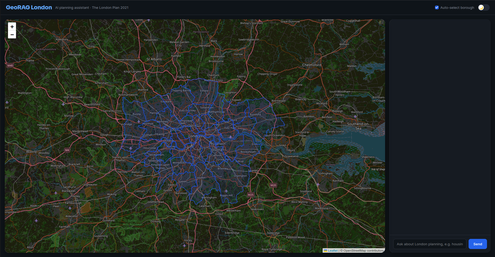

# GeoRAG London

An AI assistant that combines retrieval-augmented generation (RAG) over The London Plan 2021 with spatial data on London's 33 boroughs. Ask a question about housing, planning, or a specific borough, and get an answer grounded in the actual planning document, with the relevant area highlighted on an interactive map.



<!-- Add a screenshot or short GIF of the app here -->

## Why this project

Most RAG projects work with text alone. This one ties the text retrieval to real geographic data: when a question mentions a borough, the system pulls that borough's spatial data and population, uses it to sharpen the retrieval, and highlights it on the map alongside the generated answer.

## Features

- Interactive map of London's 33 boroughs (Leaflet), with borough boundaries, population popups, and light/dark themes
- RAG over the full text of The London Plan 2021 (381 chunks, embedded and searchable via pgvector)
- A combined endpoint that detects a mentioned borough, enriches the retrieval with that context, and returns both an answer and the matched borough
- Full Docker setup: database, backend, and frontend all run with a single command

## Tech stack

- **Backend**: FastAPI
- **Database**: PostgreSQL 16, PostGIS (spatial), pgvector (embeddings), all in one database
- **ORM / migrations**: SQLAlchemy, GeoAlchemy2, Alembic
- **LLM provider**: OpenRouter (embeddings and chat completion)
- **Frontend**: React (Vite), Leaflet
- **Containerization**: Docker, docker-compose

See [docs/architecture.md](docs/architecture.md) for the design decisions behind these choices.

## Running the project

### With Docker (recommended)

1. Copy `.env.example` to `.env` and fill in `OPENROUTER_API_KEY`
2. Run:

```bash
docker compose up -d --build
```

3. The frontend is at `http://localhost:5173`, the API at `http://localhost:8000` (interactive docs at `http://localhost:8000/docs`)

### Without Docker (local development)

Backend:

```bash
uv venv
source .venv/bin/activate
uv pip install -r requirements.txt
alembic upgrade head
uvicorn app.main:app --reload
```

Frontend:

```bash
cd frontend
npm install
npm run dev
```

## Quick start with the included database seed

Instead of re-running ingestion from scratch, which involves downloading large source files and making hundreds of embedding API calls, you can load a ready-made snapshot of the database.

1. Copy `.env.example` to `.env` and fill in `OPENROUTER_API_KEY`.
2. Start only the database first:

   `docker compose up -d db`

3. Run migrations:

   `alembic upgrade head`

4. Restore the seed:

   `docker exec -i georag_db pg_restore -U georag -d georag --clean --if-exists < db-seed/georag_seed.dump`

5. Now start the rest of the stack:

   `docker compose up -d --build`

The frontend is at `http://localhost:5173`, the API at `http://localhost:8000`.

To reproduce the data from the original sources instead, see "Data setup" below.

Instead of re-running ingestion from scratch, which involves downloading large source files and making hundreds of embedding API calls, you can load a ready-made snapshot of the database.

1. Start the database:

   `docker compose up -d db`

2. Run migrations:

   `alembic upgrade head`

3. Restore the seed:

   `docker exec -i georag_db pg_restore -U georag -d georag --clean --if-exists < db-seed/georag_seed.dump`

This loads all 33 boroughs and the full 381 embedded chunks of The London Plan 2021, so the API and frontend work immediately.

To reproduce the data from the original sources instead, see "Data setup" below.

## Data setup

Raw data files are not committed to this repo (they are large and publicly downloadable). To reproduce the dataset locally:

### 1. London borough boundaries (spatial data)

- Source: [Statistical GIS Boundary Files for London](https://data.london.gov.uk/dataset/statistical-gis-boundaries-london) (London Datastore)
- Download: `statistical-gis-boundaries-london.zip`
- Extract and place `ESRI/London_Borough_Excluding_MHW.shp` (with its companion files) at: `data/raw/london_boundaries/ESRI/`
- Original CRS: British National Grid (EPSG:27700). The ingestion script reprojects to WGS84 (EPSG:4326)

### 2. Borough population

- Source: [Land Area and Population Density, Ward and Borough](https://data.london.gov.uk/dataset/land-area-and-population-density-ward-and-borough-e1zp8) (London Datastore)
- Download: `Land Area & Population - Borough (CSV Version)`
- Place at: `data/raw/borough_population.csv`
- Uses the 2010 ONS MYE figures (the latest actual mid-year estimate before the dataset switches to projections)

### 3. The London Plan 2021 (text data for RAG)

- Source: [The London Plan 2021](https://www.london.gov.uk/programmes-strategies/planning/london-plan/london-plan-2021) (Greater London Authority, adopted March 2021)
- Download: [PDF direct link](https://www.london.gov.uk/sites/default/files/the_london_plan_2021.pdf)
- Place at: `data/raw/london_plan_2021.pdf`
- 542 pages total. A few pages fail text extraction (complex embedded graphics) and are skipped automatically with a logged warning

### Running ingestion

```bash
python3 -m scripts.ingest_boroughs      # loads 33 borough boundaries
python3 -m scripts.update_population    # adds 2010 population figures
python3 -m scripts.ingest_london_plan   # chunks and embeds the London Plan PDF
```

Set `MAX_PDF_PAGES` in `.env` to a small number (for example 50) to limit ingestion during testing on OpenRouter's free tier, or to 0 to process all 542 pages. The script is resumable: if a run is interrupted by a rate limit, re-running it continues from where it left off.

## API endpoints

- `GET /boroughs`: list all boroughs with name and population
- `GET /boroughs/{name}`: borough detail with GeoJSON geometry
- `GET /boroughs/geojson/all`: all boroughs as a single GeoJSON FeatureCollection
- `POST /chat`: RAG over the London Plan, returns an answer and source chunks
- `POST /geo-chat`: combined endpoint, detects a mentioned borough and returns an answer, sources, and the matched borough

Full interactive documentation is available at `/docs` when the API is running.

## Project structure

```
app/
  api/           FastAPI routers
  core/          configuration
  db/            SQLAlchemy models, session, Alembic migrations
  services/      embeddings and LLM calls
frontend/
  src/           React components
scripts/         one-off data ingestion scripts
data/raw/        downloaded source data (gitignored)
db-seed/         ready-made database dump (committed, see "Quick start" above)
docs/            architecture notes
```
